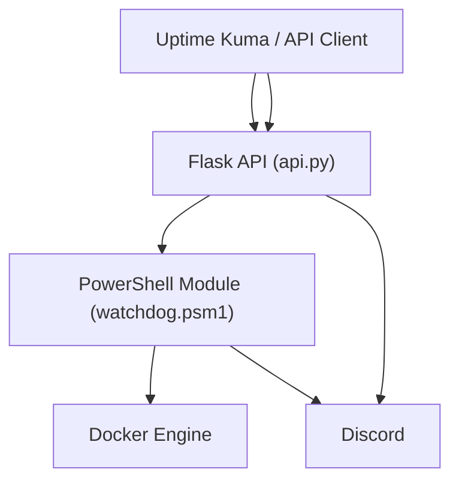

# Docker-Watchdog

<!-- TOC -->
- [Docker-Watchdog](#docker-watchdog)
  - [🚀 Features](#-features)
  - [🏗️ Architecture \& Workflow](#️-architecture--workflow)
    - [Workflow Diagram](#workflow-diagram)
  - [📁 Project Structure](#-project-structure)
  - [🧩 Module \& Script Roles](#-module--script-roles)
    - [PowerShell Module: `watchdog.psm1`](#powershell-module-watchdogpsm1)
    - [Flask API: `api.py`](#flask-api-apipy)
    - [Entrypoint: `entrypoint.ps1`](#entrypoint-entrypointps1)
    - [Update Script: `run-update.ps1`](#update-script-run-updateps1)
    - [Dockerfile](#dockerfile)
  - [📋 Requirements](#-requirements)
  - [🔧 Installation](#-installation)
    - [Using Docker Compose (Recommended)](#using-docker-compose-recommended)
    - [Using Docker CLI](#using-docker-cli)
  - [⚙️ Configuration](#️-configuration)
    - [Configuration Files](#configuration-files)
    - [Configuration Options](#configuration-options)
      - [Environment Variables](#environment-variables)
    - [Container Dependencies](#container-dependencies)
  - [🌐 API Reference](#-api-reference)
    - [Endpoints](#endpoints)
      - [`GET /health`](#get-health)
      - [`POST /restart`](#post-restart)
      - [`POST /restart-project`](#post-restart-project)
    - [API Security](#api-security)
  - [📝 Real-World Usage \& Advanced Scenarios](#-real-world-usage--advanced-scenarios)
    - [Integration with Uptime Kuma](#integration-with-uptime-kuma)
    - [CI/CD Integration](#cicd-integration)
    - [Custom Health Monitoring](#custom-health-monitoring)
    - [Edge Cases \& Troubleshooting](#edge-cases--troubleshooting)
  - [📊 Monitoring \& Logging](#-monitoring--logging)
  - [🔒 Security Considerations](#-security-considerations)
  - [🛠️ Building from Source](#️-building-from-source)
    - [Publishing to GitHub Container Registry](#publishing-to-github-container-registry)
  - [🧪 Testing \& Development](#-testing--development)
  - [📦 Image Publishing](#-image-publishing)
  - [🏥 Container Healthcheck Requirements](#-container-healthcheck-requirements)
  - [🖥️ Uptime Kuma Monitor Setup Example](#️-uptime-kuma-monitor-setup-example)
  - [📝 Changelog](#-changelog)
  - [📜 License](#-license)
  - [👥 Contributing](#-contributing)
  - [📞 Contact](#-contact)
<!-- /TOC -->


Docker-Watchdog is a robust, containerized management and automation tool for Docker Compose environments. It automatically keeps your containers up-to-date, monitors their health, and provides a RESTful API for integration with monitoring tools like Uptime Kuma. It is designed for self-hosters and DevOps engineers who want hands-off, reliable, and observable Docker operations.

---

## 🚀 Features

- **Automated Container Updates**: Scheduled Docker Compose project updates via configurable cron jobs that automatically pull the latest images and recreate containers.
- **Health Monitoring**: Real-time container health monitoring with automatic recovery actions for unhealthy containers.
- **Discord Notifications**: Detailed notifications about container updates, restarts, and health status via Discord webhooks.
- **REST API**: Flask-based API for remote management and integration with monitoring tools like Uptime Kuma.
- **Dependency Management**: Custom container dependency configurations to ensure proper restart order when dependent services need to be restarted.
- **PowerShell Core**: Cross-platform compatibility using PowerShell Core for robust container management.
- **Project Filtering**: Include/exclude specific Docker Compose projects from monitoring and updates.
- **Containerized Solution**: Runs as a container itself for easy deployment and integration into your existing Docker environment.
- **Timezone Support**: Configurable timezone for accurate logging and scheduling.
- **Intelligent Restart Logic**: Only restarts containers when actual image updates are detected.
- **Comprehensive Logging**: All actions and errors are logged with timestamps and levels, both to file and stdout.
- **Robust Error Handling**: All API endpoints and scripts include detailed error handling and validation.

---

## 🏗️ Architecture & Workflow

Docker-Watchdog is composed of three tightly integrated layers:

1. **PowerShell Module (`watchdog.psm1`)**
   - Handles all Docker Compose project discovery, update logic, health checks, dependency management, and notification logic.
   - Exposes functions for project scanning, container restarts, cron job management, and more.
2. **Flask API (`api.py`)**
   - Provides a RESTful interface for external tools (e.g., Uptime Kuma) to trigger container or project restarts.
   - Handles payload validation, error reporting, and notification dispatch.
3. **Docker Infrastructure**
   - Containerized with a multi-stage Dockerfile, using PowerShell Core and Python in a single image.
   - Uses Docker Compose for deployment and volume mounting for configuration and project access.

### Workflow Diagram



- Health events are also monitored directly by the PowerShell module via `docker events`.
- Notifications are sent to Discord via webhooks from both PowerShell and Python layers.

---

## 📁 Project Structure

```text
Docker-Watchdog/
├── app/                        # Application source code
│   ├── api/                    # Flask API code
│   │   ├── api.py              # API implementation
│   │   └── log_config.py       # Logging configuration
│   ├── config.json             # Default configuration
│   ├── entrypoint.ps1          # Container entry point script
│   ├── requirements.txt        # Python dependencies
│   ├── run-update.ps1          # Script to run update process
│   └── watchdog.psm1           # PowerShell module with core functionality
├── build.ps1                   # Build script for GitHub Container Registry
├── config.overrides.json       # User configuration overrides
├── docker-compose.example      # Example Docker Compose file
├── docker-compose.yml          # Docker Compose file for deployment
└── Dockerfile                  # Multi-stage build definition
```

---

## 🧩 Module & Script Roles

### PowerShell Module: `watchdog.psm1`

- **Project Discovery**: Scans the projects directory for Docker Compose files.
- **Update Logic**: Pulls new images, restarts only if updates are detected, and prunes unused resources.
- **Health Monitoring**: Listens to Docker health events and triggers restarts (with dependency handling) for unhealthy containers.
- **Dependency Management**: Ensures dependent containers are restarted in the correct order.
- **Notifications**: Sends Discord notifications for updates, restarts, and failures.
- **Cron Management**: Installs and manages cron jobs for scheduled updates.
- **Configuration**: Loads and merges settings from `config.json` and `config.overrides.json`.
- **Logging**: All actions are logged with timestamps and levels.

### Flask API: `api.py`

- `/health`: Simple health check endpoint.
- `/restart`: Accepts Uptime Kuma-style payloads to restart a specific container, with validation and notification.
- `/restart-project`: Accepts project restart requests, pulls latest images, and recreates containers for a named project.
- **Error Handling**: All endpoints validate payloads and return detailed error messages.
- **Logging**: Uses a custom logger with timezone-aware formatting (see `log_config.py`).

### Entrypoint: `entrypoint.ps1`

- Loads the PowerShell module, sets up environment/config, starts the Flask API (via Gunicorn), installs the updater cron job, and launches the health monitoring loop.

### Update Script: `run-update.ps1`

- Loads the PowerShell module and triggers a one-off update sweep (used by cron).

### Dockerfile

- Multi-stage build: Installs Python, PowerShell, Docker CLI, Docker Compose plugin, and all dependencies.
- Copies all scripts and configuration into the image.
- Sets up the entrypoint and healthcheck.

---

## 📋 Requirements

- Docker
- Docker Compose (v2, as a plugin)
- Docker socket access (for container management)
- Volume mounts for Docker Compose projects

---

## 🔧 Installation

### Using Docker Compose (Recommended)

1. Create a `docker-compose.yml` file based on the example provided:

   ```yaml
   x-commonKeys: &commonOptions
     restart: always
     stdin_open: true
     tty: true
   
   x-dnsServers: &dnsServers
     dns:
       - 45.90.28.29
       - 45.90.30.29
   
   services:
     watchdog:
       image: ghcr.io/the-running-dev/watchdog:latest
       container_name: watchdog
       volumes:
         - ./config.overrides.json:/app/config.overrides.json
         - /path/to/your/projects:/projects
         - ~/.docker/config.json:/root/.docker/config.json:ro
         - /var/run/docker.sock:/var/run/docker.sock
       ports:
         - 7000:80
       <<: [*dnsServers, *commonOptions]
   ```

2. Create a `config.overrides.json` file to override default settings:

   ```json
   {
     "ContainerDependencies": {
       "vpn": ["torrents", "newsgroups"]
     },
     "DiscordWebhookUrl": "YOUR_DISCORD_WEBHOOK_URL",
     "ExcludeProjects": [],
     "SendUpdaterNotifications": true,
     "SendMonitorNotifications": true,
     "SendAPINotifications": true,
     "TimeZone": "UTC",
     "UpdaterTest": false,
     "UpdaterCronJob": true,
     "UpdaterNotificationTitle": "Containers Update"
   }
   ```

3. Start the container:

   ```powershell
   docker compose up -d
   ```

### Using Docker CLI

```powershell
docker run -d \
  --name watchdog \
  -p 7000:80 \
  -v ./config.overrides.json:/app/config.overrides.json \
  -v /path/to/your/projects:/projects \
  -v ~/.docker/config.json:/root/.docker/config.json:ro \
  -v /var/run/docker.sock:/var/run/docker.sock \
  ghcr.io/the-running-dev/watchdog:latest
```

---

## ⚙️ Configuration

### Configuration Files

- `config.json`: Default configuration (inside the container)
- `config.overrides.json`: User-defined overrides (mounted as a volume)

### Configuration Options

| Option | Description | Default |
|--------|-------------|---------|
| `ProjectsDirectory` | Directory containing Docker Compose projects | `/projects` |
| `CronFilePath` | Path to cron file | `/etc/cron.d/watchdog` |
| `CronSchedule` | Cron schedule for updates | `0 4 * * *` (4 AM daily) |
| `ContainerDependencies` | Container dependencies map | `{}` |
| `DiscordWebhookUrl` | Discord webhook URL for notifications | `""` |
| `ExcludeProjects` | Projects to exclude from updates | `[]` |
| `IncludeProjects` | Projects to include (if empty, include all) | `[]` |
| `SendUpdaterNotifications` | Send notifications for updates | `true` |
| `SendMonitorNotifications` | Send notifications for monitoring events | `true` |
| `SendAPINotifications` | Send notifications for API events | `true` |
| `TimeZone` | Time zone for logs and operations | `UTC` |
| `UpdaterTest` | Run updater in test mode | `false` |
| `UpdaterCronJob` | Enable updater cron job | `true` |
| `UpdaterNotificationTitle` | Title for update notifications | `Containers Update` |

#### Environment Variables

You can override most configuration options using environment variables. Common variables include:

- `PORT`: The port the Flask API listens on (default: 80)
- `DISCORD_WEBHOOK_URL`: Discord webhook for notifications
- `TIME_ZONE`: Timezone for logs and scheduling (e.g., `America/New_York`)
- `SEND_API_NOTIFICATIONS`: Enable/disable API notifications (`true`/`false`)

### Container Dependencies

Define container dependencies to ensure proper restart order. For example:

```json
"ContainerDependencies": {
  "vpn": ["torrents", "newsgroups"]
}
```

In this example, if the `vpn` container is restarted, the `torrents` and `newsgroups` containers will also be restarted in that order.

---

## 🌐 API Reference

The Docker-Watchdog API is available on port 80 within the container (mapped to your chosen external port). The API is built with Flask and uses Gunicorn as the WSGI server for production deployments.

### Endpoints

#### `GET /health`

- **Description**: Health check endpoint.
- **Response**:

```json
{
  "status": "healthy"
}
```

#### `POST /restart`

- **Description**: Restart a Docker container based on a monitoring payload (e.g., from Uptime Kuma).
- **Request Example**:

```json
{
  "monitor": {
    "name": "my-service",
    "description": "container-my-service",
    "url": "http://localhost:8080"
  },
  "heartbeat": {
    "status": 0,
    "timezone": "UTC"
  }
}
```

- **Response (Success)**:

```json
{
  "status": "my-service Restarted"
}
```

- **Response (Container Not Found)**:

```json
{
  "error": "container_not_found",
  "details": "Container 'my-service' Not Found",
  "container": "my-service"
}
```

- **Response (Error)**:

```json
{
  "error": "failed",
  "details": "...error message...",
  "container": "my-service"
}
```

#### `POST /restart-project`

- **Description**: Restart a Docker Compose project by name, pulling latest images and recreating containers.
- **Request Example**:

```json
{
  "event": "update-project",
  "data": {
    "projectId": "myproject",
    "additionalArgs": ["--remove-orphans"],
    "isTest": false
  }
}
```

- **Response (Success)**:

```json
{
  "status": "Project 'myproject' Restarted Successfully.",
  "additionalArgs": ["--remove-orphans"]
}
```

- **Response (Error)**:

```json
{
  "error": "Docker Compose Pull Failed",
  "details": "...error message..."
}
```

### API Security

- The API is intended for use within trusted networks or behind a reverse proxy with authentication.
- No authentication is enabled by default; add a reverse proxy (e.g., Traefik, Nginx) for production security.

---

## 📝 Real-World Usage & Advanced Scenarios

### Integration with Uptime Kuma

- Configure Uptime Kuma to send a webhook to `/restart` when a container is detected as unhealthy.
- Docker-Watchdog will validate the payload, restart the container, and send a Discord notification.

### CI/CD Integration

- Use the `/restart-project` endpoint in your CI/CD pipeline to trigger zero-downtime rolling updates after a new image is pushed.
- Example GitHub Actions step:

```yaml
- name: Trigger Watchdog Project Restart
  run: |
    curl -X POST http://your-watchdog-host:7000/restart-project \
      -H 'Content-Type: application/json' \
      -d '{"event":"update-project","data":{"projectId":"myproject","additionalArgs":["--remove-orphans"],"isTest":false}}'
```

### Custom Health Monitoring

- Use the PowerShell module directly to build custom health checks or restart logic.
- Extend the Discord notification logic for other chat platforms by modifying the notification functions.

### Edge Cases & Troubleshooting

- **Cron Not Running**: Ensure the container is started with `--cap-add=SYS_TIME` if you need to set the system time or run cron jobs in some environments.
- **Docker Socket Permissions**: The container must have access to `/var/run/docker.sock` and the user must have permission to manage Docker.
- **Project Not Detected**: Ensure your Compose files are named `docker-compose.yml` or `docker-compose.*.yml` and are in the mapped projects directory.
- **Timezone Issues**: Set the `TIME_ZONE` environment variable to a valid IANA timezone string.

---

## 📊 Monitoring & Logging

- All actions, errors, and health events are logged to `/tmp/watchdog.log` and to stdout.
- Log entries include timestamps (with timezone offset), log level, and message.
- The Flask API uses a custom logger with timezone-aware formatting (see `log_config.py`).

---

## 🔒 Security Considerations

- The API is unauthenticated by default. For production, restrict access to trusted networks or use a reverse proxy with authentication.
- Discord webhook URLs should be kept secret; do not commit them to version control.
- The container requires access to the Docker socket; only run on trusted hosts.

---

## 🛠️ Building from Source

```powershell
# Clone the repository
git clone https://github.com/the-running-dev/docker-watchdog.git
cd docker-watchdog

# Build the image locally
docker build -t watchdog:local .

# Run the container
docker compose -f docker-compose.example up -d
```

### Publishing to GitHub Container Registry

The project includes scripts for publishing the image to GitHub Container Registry:

```powershell
# Set your GitHub PAT with package write permissions
$env:GitHubPackagesToken = 'your-github-pat'

# Build and push
./build.ps1
```

---

## 🧪 Testing & Development

- To build and run locally, use the provided `docker-compose.yml` or `docker-compose.example`.
- For local development, you can mount your source code and config files directly into the container.
- Use `run.ps1` or `run.sh` for quick local rebuilds.
- All scripts are cross-platform (Linux/Windows/Mac) via PowerShell Core.

---

## 📦 Image Publishing

To publish your own image to GitHub Container Registry:

```powershell
# Set your GitHub PAT with package write permissions
$env:GitHubPackagesToken = 'your-github-pat'

# Build and push
./build.ps1
```

---

## 🏥 Container Healthcheck Requirements

For Docker-Watchdog to monitor and automatically recover containers, your Docker Compose services **must define a healthcheck**. The healthcheck status is used to determine if a container is healthy or needs to be restarted.

**Example Docker Compose healthcheck:**

```yaml
services:
  torrents:
    image: your-torrent-image
    healthcheck:
      test: ["CMD", "curl", "-f", "http://localhost:8080/health"]
      interval: 30s
      timeout: 10s
      retries: 3
      start_period: 10s
```

- The `healthcheck` section is required for each service you want Docker-Watchdog to monitor.
- The health status (`healthy`/`unhealthy`) is what triggers automatic restarts and notifications.

---

## 🖥️ Uptime Kuma Monitor Setup Example

To integrate Uptime Kuma with Docker-Watchdog for a container (e.g., `container-torrents`):

1. **Set up a webhook notification to Docker-Watchdog:**
   - Go to **Settings > Notifications > Set Up Notification** in Uptime Kuma.
   - **Name:** Watchdog
   - **Notification Type:** Webhook
   - **Post URL:** `http://<watchdog-host>:7000/restart`
   - **Request Body Preset:** `application/json`

2. **Create a monitor and enable the Watchdog notification:**
   - Create a new monitor for your container
   - **Enable the Watchdog notification** for this monitor.
   - In the **Description** field, enter the container to be restarted (e.g., `container-torrents` will restart the `torrents` container).
   - The description is used by Docker-Watchdog to map the monitor to the correct container.

   **Example Description:**
   ```
   container-torrents
   ```

   **Example Payload Sent by Uptime Kuma:**
   ```json
   {
     "monitor": {
       "name": "container-torrents",
       "description": "container-torrents",
     },
     "heartbeat": {
       "status": 0,
       "timezone": "UTC"
     }
   }
   ```

3. **How it works:**
   - When Uptime Kuma detects the container is down/unhealthy, it sends a webhook to Docker-Watchdog.
   - Docker-Watchdog parses the payload, restarts the container specified in the description, and sends a notification (e.g., to Discord).

---

## 📝 Changelog

See [CHANGELOG.md](CHANGELOG.md) for release notes and version history.

---

## 📜 License

[MIT License](LICENSE)

---

## 👥 Contributing

Contributions are welcome! Please feel free to submit a Pull Request.

---

## 📞 Contact

For questions or support, please open an issue on GitHub.

---

Made with ❤️ by the Running Dev